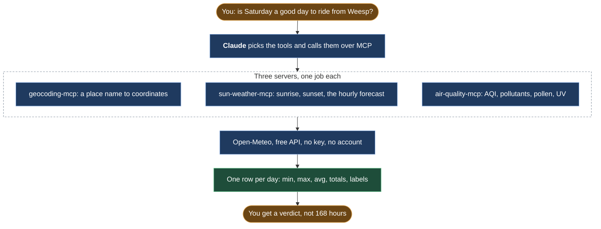

# public-mcp-servers

Three MCP servers that give Claude geocoding, sunrise and forecast, and air quality with pollen and UV. All from Open-Meteo's free API, folded from hours into one row per day.

## Preview

```
You:    Is Saturday a good day to ride from Weesp?

Claude: Weesp is at 52.31, 5.04. Saturday: feels-like 9 to 12 C, wind 10 km/h ENE,
        gusts to 20, no rain, cloud 25%. Sunrise 08:05, sunset 18:40.
        Air quality Good (European AQI 18, driven by ozone), grass pollen low,
        peak UV 3.8, Moderate.
        Yes, Saturday. Sunday has gusts to 45 km/h and rain from 14:00.
```

## What it does



1. `geocoding-mcp` turns a city name or a postal code into coordinates, country and timezone, up to five matches, and looks a location up by its Open-Meteo id.
2. `sun-weather-mcp` gives sunrise and sunset for a day or a range of up to 16 days, and a forecast of 1 to 7 days where every day is one row: temperature and feels-like (min, max, avg), wind and gusts, the dominant wind direction as a compass point, rain total and chance, cloud, humidity.
3. `air-quality-mcp` gives current air quality with the European AQI label, a 1 to 7 day forecast and a historical range folded to daily rows, a pollen forecast (grass, birch, alder, mugwort, ragweed, olive) as daily peaks, the UV peak per day with its risk level, and an AQI breakdown that names the pollutant driving the index.

**Constraints:** no API key, no account, nothing stored. Every tool is one read-only call to Open-Meteo's free API, and the folding from hours to days is plain TypeScript. The tests run without network.

## Why this exists

I built these for the timing step of my gravel ride skills, [gravel-ride-plan](https://github.com/nunomnferreirapt/gravel-ride-plan). That step compares days, and a day is not a list of hours: it is a feels-like range, a gust ceiling, a rain chance, a pollen peak. Open-Meteo already had every number, but in hours: 168 of them for a week. So each server does one job and folds the hours into one row per day.

## Requirements

- Node 20 or later
- Claude Code, or any MCP client that speaks stdio

## Install

```bash
git clone https://github.com/nunomnferreirapt/public-mcp-servers.git
cd public-mcp-servers
for s in geocoding-mcp sun-weather-mcp air-quality-mcp; do (cd "$s" && npm install); done
claude mcp add -s user geocoding-mcp -- npx tsx "$PWD/geocoding-mcp/src/index.ts"
claude mcp add -s user sun-weather-mcp -- npx tsx "$PWD/sun-weather-mcp/src/index.ts"
claude mcp add -s user air-quality-mcp -- npx tsx "$PWD/air-quality-mcp/src/index.ts"
```

Register only the ones you want; each server stands alone. `claude mcp list` should show all three connected. To run the tests, `npm test` inside a server's folder.

## Usage

Ask in plain words and Claude picks the tools. The twelve tools, by server:

- geocoding-mcp: `geocode_city`, `geocode_postal_code`, `get_location_by_id`
- sun-weather-mcp: `get_sunrise_sunset`, `get_sunrise_sunset_range`, `get_weather_forecast`
- air-quality-mcp: `get_air_quality_current`, `get_air_quality_forecast`, `get_air_quality_historical`, `get_pollen_forecast`, `get_uv_index`, `get_aqi_breakdown`

Every result is JSON with the timezone Open-Meteo resolved for the coordinates, so times are local to the place, not to your machine.

## How hours become a daily verdict

Open-Meteo answers with arrays of hours. Each server groups them by date and folds every field the way a rider or a planner reads it: minimum, maximum and average for temperature, feels-like, wind and humidity; a total for rain; a peak for gusts, rain chance, UV and each pollen; the average bearing for wind turned into one of sixteen compass points. Labels come from the public bands, the European AQI scale and the UV index scale, and are applied to the day's peak, since the worst hour is the one that decides. A missing hour is skipped, never counted as zero. The AQI breakdown reports the highest sub-index as the driving pollutant. All of this lives in each server's `src/lib.ts`, with no network, and that is what the tests cover.

## Repository layout

```
geocoding-mcp/     src/index.ts (the server), src/lib.ts (the pure parts), tests/
sun-weather-mcp/   same shape
air-quality-mcp/   same shape
```

Each server is its own npm package with `@modelcontextprotocol/sdk`, `zod` and `tsx` as its only dependencies.

## License

MIT, see `LICENSE`.

Built by [Nuno Ferreira](https://www.linkedin.com/in/nunomnferreira).
